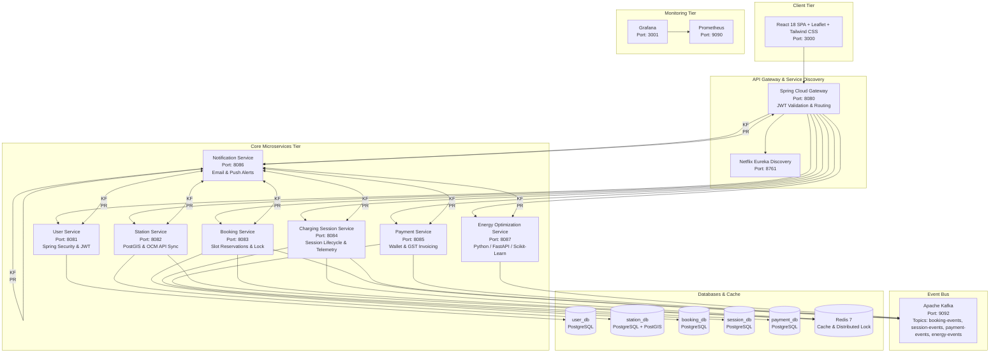

# ⚡ SmartCharge: Smart EV Charging & Intelligent Energy Optimization Platform


A full-stack, distributed microservices platform designed to simplify electric vehicle (EV) charging across India. It connects EV drivers with charging stations, offers slot reservations and charging session monitoring, integrates real-world Indian charging station data (Open Charge Map & Bureau of Energy Efficiency - BEE), and features an AI-powered Energy Optimization Engine for predictive grid load balancing.

---

## 🏛️ System Architecture



---

## 🚀 Key Platform Highlights

1. **Real-world Indian EV Datasets**:
   - Integrated Open Charge Map (OCM) and BEE (Bureau of Energy Efficiency) stations in Mumbai, Delhi NCR, Bengaluru, Hyderabad, Chennai, Pune, Ahmedabad.
   - Pre-seeded database with stations from Tata Power, Statiq, ChargeZone, Ather Grid, and EESL.
2. **AI / ML Energy Optimization Engine**:
   - Random Forest Regression for 24-hour EV demand prediction.
   - Indian peak-hour detection (08:00–10:30 AM & 06:00–09:30 PM).
   - Dynamic power distribution algorithms (fair-share, priority-based, fastest turnaround).
   - Real-time carbon savings calculator and petrol-offset metrics.
3. **Microservices Best Practices**:
   - Database-per-service pattern with independent PostgreSQL schemas.
   - PostGIS geographical queries with Haversine distance calculations.
   - Redis distributed locking to prevent slot double-booking race conditions.
   - Asynchronous event-driven architecture via Apache Kafka.
   - Stateless JWT authentication enforced at Spring Cloud Gateway.

---

## 🔌 Microservices & Port Allocations

| Service | Port | Tech Stack | Responsibility |
|---|---|---|---|
| **Frontend** | `3000` | React 18, Leaflet, Tailwind | User interface, interactive map, dashboards |
| **API Gateway** | `8080` | Spring Cloud Gateway | Edge routing, CORS, JWT authentication |
| **Eureka Discovery** | `8761` | Netflix Eureka | Dynamic service registration and discovery |
| **User Service** | `8081` | Spring Boot, Spring Security | Authentication, RBAC, user profiles |
| **Station Service** | `8082` | Spring Boot, PostGIS, Redis | Station catalogue, connectors, OCM importer |
| **Booking Service** | `8083` | Spring Boot, Redis Lock | Slot reservations, double-booking prevention |
| **Charging Session Service** | `8084` | Spring Boot, Redis | Real-time session telemetry, kW tracking |
| **Payment Service** | `8085` | Spring Boot | Prepaid SmartWallet, UPI payments, GST billing |
| **Notification Service** | `8086` | Spring Boot, JavaMail | Kafka-driven email and push alerts |
| **Energy Optimization Service** | `8087` | Python 3.11, FastAPI, Scikit-learn | Demand prediction, load balancing, ML engine |
| **Apache Kafka** | `9092` | Confluent Kafka 7.4 | Distributed event streaming |
| **Prometheus** | `9090` | Prometheus | Metrics collection across all services |
| **Grafana** | `3001` | Grafana | Visualization dashboards |

---

## 🛠️ Quick Start with Docker Compose

### Prerequisites
- Docker & Docker Compose
- Java 21 & Maven 3.9+ (optional for local builds)
- Node.js 20+ (optional for frontend development)
- Python 3.11+ (optional for ML development)

### 1. Clone the repository
```bash
git clone https://github.com/Helion564/smartcharge.git
cd smartcharge
```

### 2. Configure Environment Variables
A configured `.env` file is included in the root directory:
```bash
# Review or update keys in .env
cat .env
```

### 3. Launch the Complete Ecosystem
```bash
docker-compose up --build -d
```

### 4. Access the Applications
- **Web App**: [http://localhost:3000](http://localhost:3000)
- **API Gateway**: [http://localhost:8080](http://localhost:8080)
- **Eureka Dashboard**: [http://localhost:8761](http://localhost:8761)
- **Energy Optimization API**: [http://localhost:8087/docs](http://localhost:8087/docs)
- **Prometheus Metrics**: [http://localhost:9090](http://localhost:9090)
- **Grafana Monitoring**: [http://localhost:3001](http://localhost:3001) (User: `admin`, Pass: `admin123`)

---

## 🧪 Default Test Accounts

| Role | Email | Password | Access Scope |
|---|---|---|---|
| **EV Driver** | `driver@smartcharge.in` | `SmartCharge@123` | Station search, booking slots, wallet |
| **Station Operator** | `operator@smartcharge.in` | `SmartCharge@123` | Operator hub, connector status |
| **Administrator** | `admin@smartcharge.in` | `SmartCharge@123` | Full access, AI engine, Eureka |

---

## 📡 REST API Documentation

### Authentication (`/api/v1/auth`)
- `POST /register`: Create new EV Driver or Operator account
- `POST /login`: Authenticate and receive JWT access and refresh tokens
- `POST /refresh`: Refresh an expired access token

### Stations (`/api/v1/stations`)
- `GET /nearby`: Geo-search charging stations by radius, connector type, and kW power
- `GET /{stationId}`: Get comprehensive station details and connector list
- `GET /{stationId}/availability`: Real-time cached connector availability

### Bookings (`/api/v1/bookings`)
- `POST /`: Reserve a charging connector slot
- `GET /my`: View all upcoming and past bookings
- `PUT /{bookingId}/cancel`: Cancel an active booking

### Energy Optimization AI (`/api/v1/energy`)
- `POST /predictions/demand`: Predict hourly demand using Random Forest model
- `GET /predictions/peak-hours/{stationId}`: Identify diurnal peak demand windows
- `POST /optimization/allocate`: Dynamically balance available kW among active sessions
- `GET /analytics/carbon-savings`: Calculate kilograms of CO2 avoided

---

## 📄 License
This project is licensed under the Apache 2.0 License.
